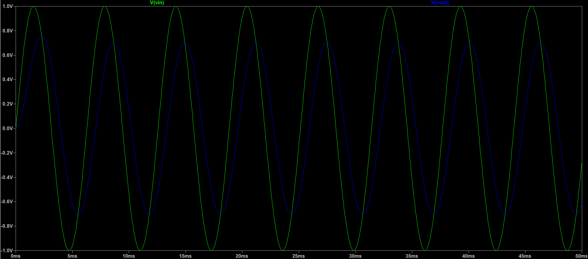
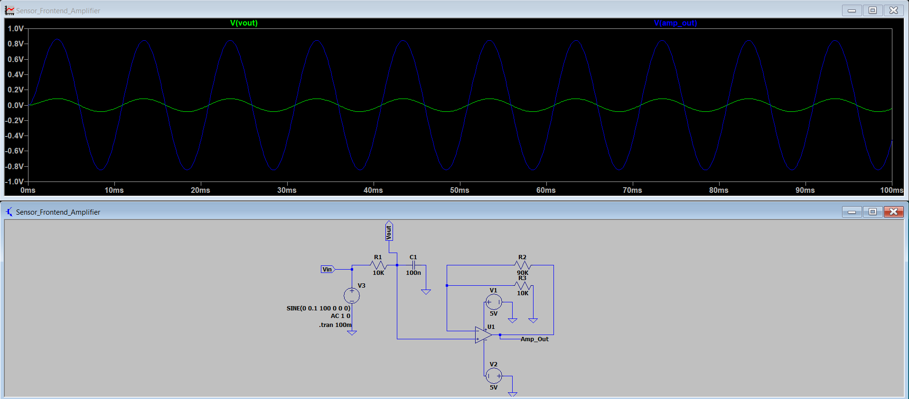
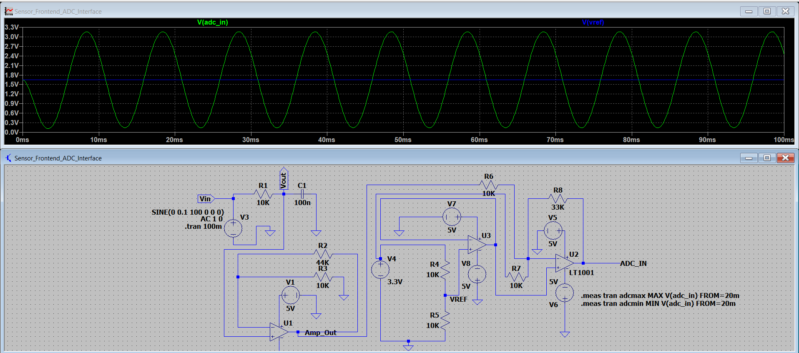
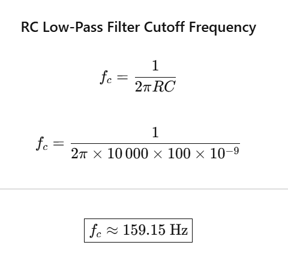

# Sensor Signal Conditioning and ADC Interface

This project is about designing and simulating a sensor signal-conditioning circuit and using it with an ADC interface. I used LTspice for the analog circuit, Python for ADC sampling analysis, and STM32CubeIDE for the firmware.

## What I wanted to do

- Design an RC low-pass filter to reduce higher-frequency components.
- Use op-amp stages for signal conditioning.
- Generate a 1.65 V reference voltage.
- Shift and scale the signal for a 0–3.3 V ADC input.
- Understand how sampling rate and ADC resolution affect the signal.
- Write STM32 firmware to read ADC values and send them over UART.

## Circuit Overview

The circuit has four main stages:

1. RC low-pass filter using a 10 kΩ resistor and 100 nF capacitor.
2. Amplifier stage to condition the filtered signal.
3. Reference voltage stage using a resistor divider and buffer to generate approximately 1.65 V.
4. ADC interface to keep the output within the intended 0–3.3 V range.

## Circuit and Simulation

### Filter Frequency Response

### Transient Response

### ADC Output Range

### Cutoff Frequency Calculation

## Simulation Results

| Parameter | Result |
|---|---:|
| RC filter cutoff frequency | 159.15 Hz |
| Reference voltage | 1.64998 V |
| ADC output DC voltage | 1.64985 V |
| Minimum ADC output | 0.14113 V |
| Maximum ADC output | 3.15856 V |
| Peak-to-peak output swing | 3.01743 V |

For the input signal tested, the simulated output stays within the nominal 0–3.3 V range.

The cutoff frequency is calculated using:

fc = 1 / (2πRC)

For R = 10 kΩ and C = 100 nF, the cutoff frequency is approximately 159.15 Hz.

## Python ADC Analysis

I also worked on Python scripts to explore ADC sampling and quantization. The aim is to understand how different sampling rates affect the digital representation of a signal.

The related files are in the `adc_simulation/` folder.

## STM32 Firmware

I created firmware for the STM32F411CEU6 using STM32CubeMX and STM32CubeIDE.

- 12-bit ADC using ADC1 channel 0 (PA0).
- ADC readings converted into voltage values.
- USART2 configured for serial output at 115200 baud.
- System clock configured for 100 MHz.

The firmware builds successfully in STM32CubeIDE, and the compiled HEX file is included in `stm32_firmware/build/`.

I have not tested the firmware on a physical STM32 board yet, so the actual ADC readings and UART output are not verified on hardware.

More details are in [`stm32_firmware/README.md`](stm32_firmware/README.md).

## Tools Used

- LTspice 26.1.1
- Python
- STM32CubeMX
- STM32CubeIDE
- STM32F411CEU6

## How to Run

### LTspice

1. Open `Sensor_Frontend_ADC_Interface.asc` in LTspice.
2. Run the simulation.
3. Check the waveforms and output voltages.
4. Open the simulation log to see the measured values.

### Python

Open the `adc_simulation/` folder and follow the instructions there to run the analysis scripts.

### STM32 Firmware

Open the firmware project in STM32CubeIDE and build it. To check actual ADC readings and UART output, the firmware still needs to be tested on a physical board.

## Limitations and Future Work

- Test the circuit with physical components.
- Verify ADC readings and UART output on the STM32 board.
- Compare physical measurements with LTspice results.
- Explore component tolerances and ADC input protection.

## License

The main project uses the MIT License. Third-party STM32 HAL and CMSIS components have their own license terms.
